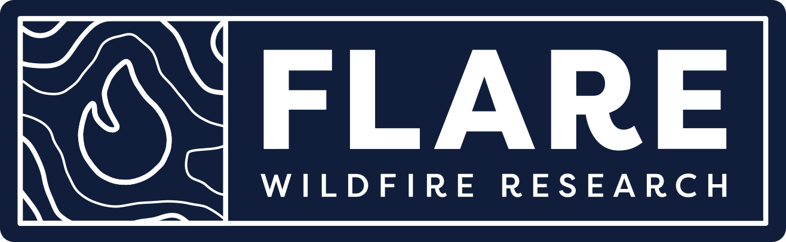
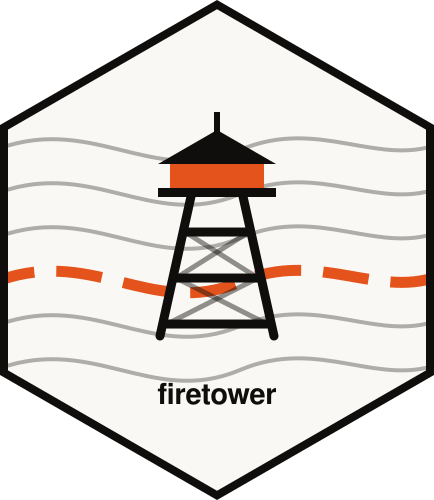

  

  

<h1 align="center">Firetower</h1>

<b>Seasonal fire conditions from FLARE Wildfire Research</b>

  <a href="https://showcase.firetower.com.au"><b>Explore the demos →</b></a>

---

**Fire science you can look at.** Firetower turns research from the School of Agriculture, Food and Ecosystem Sciences at The University of Melbourne into maps, charts and seasonal outlooks, updated on a stated schedule, with the source of every product recorded.

> *In development. Public tier expected 2027.*

## What Firetower covers

Fire needs four things to line up: **ignition**, **fuel availability**, **fuel load** and **weather**. Our products are organised around those four switches.

| Section | What you'll find | Cadence |
|:--|:--|:--|
| **Trend** | Season-to-date measures against the historical record: fire danger, area burnt, ignitions, severity | daily to weekly |
| **Forecast** | Modelled conditions over the coming days: soil and fuel moisture, vapour pressure deficit, ignition potential | daily |
| **Fire view** | Satellite observations through the season: burn severity, hotspot progression, ignition locations | hourly to per pass |

## Try the demos

Working previews live at **[showcase.firetower.com.au](https://showcase.firetower.com.au)**:

- 💧 **Water and fuel moisture:** root-zone soil moisture with a seasonal outlook, live fuel moisture at 20 m, and moisture metrics compared at native resolution
- 🌡️ **Vapour pressure deficit:** in-forest VPD and ignition probability
- 🌏 **Climate drivers:** where ENSO, the Indian Ocean Dipole and the Southern Annular Mode stand, and how each leans the fire season
- 🌳 **Fuel load:** biomass and canopy height models for Australia, side by side
- 🗺️ **Daily forecasts:** BoM national forecast grids and the Cinis Victorian fire spread forecast

## Where the data comes from

Bureau of Meteorology · NASA MODIS and VIIRS · ESA Copernicus Sentinel-2 · Geoscience Australia · FLARE's own models for ignition, significant-fire potential, live fuel moisture and terrain downscaling.

## ⚠️ Not an emergency service

Firetower carries no live incidents, warnings or evacuation information. For emergency information, refer to your state emergency service.

---

© FLARE Wildfire Research · School of Agriculture, Food and Ecosystem Sciences · The University of Melbourne

